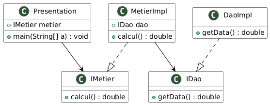

# TP 1 : Inversion de Contrôle (IoC) et Injection de Dépendances (DI)

## 📌 Présentation du Projet
Ce projet illustre les concepts fondamentaux de l'**Inversion de Contrôle (IoC - *Inversion of Control*)** et de l'**Injection de Dépendances (DI - *Dependency Injection*)** en Java, qui constituent le cœur architectural des frameworks modernes tels que **Spring**.

L'objectif est de concevoir une application modulaire respectant les principes **SOLID** (notamment le *Single Responsibility Principle* et l'*Open/Closed Principle*), et de comparer deux modes d'injection :
1. **L'instanciation statique** (couplage fort via l'opérateur `new`).
2. **L'instanciation dynamique** (couplage faible via la **réflexion Java** et un fichier de configuration externe).

---

## 📐 Architecture & Diagramme de Classes

L'application est découpée en 3 couches distinctes :
* **Couche DAO (Data Access Object)** : Abstraction et accès aux données.
* **Couche Métier** : Traitement et logique business.
* **Couche Présentation** : Point d'entrée de l'application et orchestration de l'injection.



---

## 📂 Structure du Projet

```text
TP1_LAB1/
├── config.txt                                     # Fichier de configuration pour la réflexion dynamique
├── pom.xml                                        # Configuration Maven
├── src/
│   ├── main/
│   │   ├── java/
│   │   │   └── com/
│   │   │       └── example/
│   │   │           ├── dao/
│   │   │           │   ├── IDao.java              # Interface DAO (Contrat de persistance)
│   │   │           │   └── DaoImpl.java          # Implémentation concrète du DAO
│   │   │           ├── metier/
│   │   │           │   ├── IMetier.java           # Interface Métier
│   │   │           │   └── MetierImpl.java        # Implémentation Métier avec setter d'injection
│   │   │           └── presentation/
│   │   │               ├── Presentation1.java     # Version Statique (Couplage fort)
│   │   │               └── Presentation2.java     # Version Dynamique (Réflexion Java)
│   │   └── resources/
│   │       └── config.txt                         # Copie dans les ressources du classpath
└── target/                                        # Fichiers compilés (.class)
```

---

## 🛠️ Description des Composants

### 1. Couche DAO
* **`IDao`** : Interface définissant la méthode `double getValue()` (et `getData()` par défaut). Elle permet au métier de ne pas dépendre d'une implémentation concrète.
* **`DaoImpl`** : Implémente `IDao` et simule la récupération d'une valeur (ici `100.0`).

### 2. Couche Métier
* **`IMetier`** : Interface définissant la méthode `double calcul()`.
* **`MetierImpl`** : Implémente `IMetier`. Elle déclare une référence vers `IDao` et fournit une méthode `setDao(IDao dao)` pour permettre l'injection de dépendances. La méthode `calcul()` effectue l'opération métier `valeurBase * 2`.

### 3. Fichier de Configuration (`config.txt`)
Le fichier `config.txt` contient les noms pleinement qualifiés (*fully qualified names*) des classes à instancier :
```text
com.example.dao.DaoImpl
com.example.metier.MetierImpl
```

---

## 🚀 Compilation & Exécution

### 1. Compilation du Projet avec Maven
Pour compiler les classes Java :
```bash
mvn clean compile
```

#### 📸 Résultat de la compilation :


---

### 2. Version 1 : Instanciation Statique (`Presentation1`)
Dans `Presentation1`, les dépendances sont créées directement avec le mot-clé `new` :
```java
DaoImpl dao = new DaoImpl();
MetierImpl metier = new MetierImpl();
metier.setDao(dao);
double resultat = metier.calcul();
```

Commande d'exécution :
```bash
java -cp target/classes com.example.presentation.Presentation1
```

#### 📸 Résultat d'exécution :


---

### 3. Version 2 : Instanciation Dynamique par Réflexion (`Presentation2`)
Dans `Presentation2`, aucune classe concrète n'est référencée dans le code. Le conteneur :
1. Lit les noms des classes depuis le fichier `config.txt`.
2. Charge et instancie les classes dynamiquement via `Class.forName()` et `Constructor.newInstance()`.
3. Récupère la méthode setter `setDao` et l'invoque dynamiquement via `Method.invoke()`.
4. Exécute le traitement métier.

Commande d'exécution :
```bash
java -cp target/classes com.example.presentation.Presentation2
```

#### 📸 Résultat d'exécution :


---

## ⚖️ Comparaison : Statique vs Dynamique

| Critère | `Presentation1` (Statique) | `Presentation2` (Dynamique / Réflexion) |
| :--- | :--- | :--- |
| **Création d'objets** | En dur avec `new` (`new DaoImpl()`) | Par réflexion (`Class.forName(...)`) |
| **Couplage** | **Fort** (dépend des classes d'implémentation) | **Faible** (dépend uniquement des interfaces `IDao` et `IMetier`) |
| **Évolution** | Nécessite de modifier le code Java et de recompiler | Il suffit de modifier `config.txt` sans recompiler |
| **Principe OCP** | Non respecté | **Respecté** (ouvert à l'extension, fermé à la modification) |
| **Lien avec Spring** | Programmation classique sans IoC | Cœur de fonctionnement du conteneur IoC de Spring |

---

## 🎯 Conclusion
Ce TP met en évidence l'intérêt de la **programmation orientée interfaces** et de l'**injection de dépendances**. Grâce à la réflexion Java et au fichier de configuration, l'application devient totalement modulable, facilitant les tests unitaires (via des Mocks) et l'interchangeabilité des sources de données.

"Dans Presentation1, le développeur décide du câblage dans le code source au moment de la compilation. Dans Presentation2, nous appliquons le principe d'Inversion de Contrôle (IoC) : c'est un conteneur externe qui lit un fichier de configuration et injecte les dépendances au moment de l'exécution grâce à la réflexion Java."